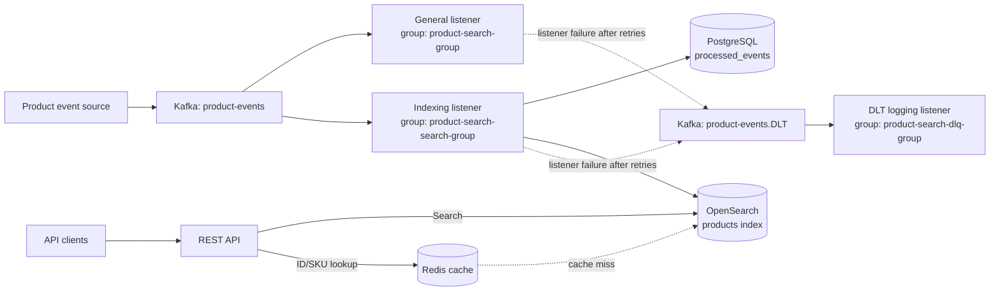

# Product Search

`product-search` is an event-driven read-model projection service for the
product catalog. It consumes product mutation events from Kafka, validates
them against a versioned JSON Schema and consumer-side invariants, and
maintains product search documents in OpenSearch. A PostgreSQL inbox tracks
processed event IDs and aggregate versions; Redis provides rebuildable API
response caching.

The catalog remains the source of truth. Product writes, the transactional
outbox, and Debezium CDC are upstream responsibilities of `product-catalog`
and the platform repositories (`platform-infrastructure` and
`platform-gitops`). This service owns the Kafka consumer, inbox, search
projection, API, and DLT logging—not outbox publication or connector
deployment.

> **Production security notice:** This application does not enforce
> authentication or authorization. OpenAPI security annotations are
> documentation only. Do not expose the API or management endpoints directly
> to untrusted networks; use an authenticated gateway or implement and verify
> application security before production use.

## Contents

- [Architecture](#architecture)
- [Technology stack](#technology-stack)
- [Project structure](#project-structure)
- [Prerequisites](#prerequisites)
- [Configuration](#configuration)
- [Getting started](#getting-started)
- [Run locally](#run-locally)
- [Docker](#docker)
- [API](#api)
- [API documentation](#api-documentation)
- [Testing](#testing)
- [Observability and health](#observability-and-health)
- [CI and container publishing](#ci-and-container-publishing)
- [Design considerations and next steps](#design-considerations-and-next-steps)
- [License](#license)

## Architecture



The upstream catalog publishes authoritative events to Kafka using a
transactional outbox and Debezium CDC. OpenSearch is the read/search
projection, Redis is a rebuildable cache, and PostgreSQL stores the consumer
inbox used for idempotency and aggregate-version checks. The general
processing and indexing listeners use separate consumer groups and receive
events independently. The indexing listener applies deterministic document
upserts/deletes and records inbox metadata; OpenSearch and PostgreSQL cannot
commit atomically. Flyway applies the inbox migration at application startup.

Listener failures are retried before a `DeadLetterPublishingRecoverer` routes
the record to `<source-topic>.DLT`. The DLT listener consumes raw bytes and
logs the failure; it does not repair or replay the projection. Failed
deserialization payload bytes are preserved when publishing to the DLT.

### Product event contract

The default source topic is `product-events`. Messages are JSON representations
of `ProductEvent`:

```json
{
  "schemaVersion": 1,
  "eventId": "7df16f23-9bd6-4d8c-9c7c-8128f2ae8020",
  "version": 1,
  "productId": 123,
  "sku": "SKU-98765",
  "name": "Ergonomic Mechanical Keyboard",
  "description": "Wireless mechanical keyboard",
  "price": 149.99,
  "stockQuantity": 42,
  "eventType": "CREATED",
  "timestamp": "2026-10-25T12:00:00"
}
```

The checked-in JSON Schema at
`src/main/resources/schemas/product-event-v1.schema.json` is enforced by the
Kafka value deserializer before application listeners receive events.
`schemaVersion` must be `1`; `version` is a required integer with a minimum
value of `1`. Unsupported schema versions, malformed JSON, and incompatible
payloads fail deserialization and enter the retry/dead-letter flow. This
repository versions the schema in source control; it does not use a Schema
Registry.

`eventType` is `CREATED`, `UPDATED`, or `DELETED`. All events require a UUID
`eventId`, positive numeric `productId`, positive integer `version`, event
type, and timestamp. Create/update events also require nonblank SKU and name,
nonnegative price, and nonnegative stock quantity. Delete events are applied
by product ID. The timestamp is descriptive and is not used for ordering.

The consumer rejects incoming versions less than or equal to the highest
version in the inbox or (for indexed documents) OpenSearch. It does not treat a
missing version as zero or silently acknowledge stale/equal aggregate
versions. An already-recorded `eventId` is an idempotent duplicate and is
acknowledged without repeating side effects. Invalid payloads, including null
events or missing required fields, fail explicitly so Kafka recovery can
retry and route them to the DLT.

Listener failures are retried three times with a one-second backoff after the
initial attempt. After retries, records are published to
`<source-topic>.DLT` at the original partition number. OpenSearch indexing and
inbox persistence form a non-atomic boundary: if indexing succeeds but inbox
save fails, the exception propagates for Kafka retry. Re-delivery must remain
a deterministic upsert/delete; do not rely on a Redis cache entry for
deduplication.

### CDC outbox integration contract

This repository is the consumer side only. It does not own the catalog's
products table, an outbox table, Debezium, Kafka Connect, Kafka topics, or
platform deployment manifests. Those resources belong in `product-catalog`,
`platform-infrastructure`, and `platform-gitops`, respectively. The handoff
contract should be:

- In one catalog database transaction, mutate the product and insert one
  immutable outbox row. A rollback must remove both changes; the request path
  must not publish directly to Kafka.
- Use a UUID event ID and a monotonically increasing version allocated with
  the product mutation. A PostgreSQL schema can enforce the contract like
  this:

  ```sql
  CREATE TABLE outbox_events (
      id               UUID PRIMARY KEY,
      aggregate_type   TEXT NOT NULL,
      aggregate_id     TEXT NOT NULL,
      aggregate_version BIGINT NOT NULL CHECK (aggregate_version > 0),
      event_type       TEXT NOT NULL CHECK (event_type IN ('CREATED', 'UPDATED', 'DELETED')),
      payload          JSONB NOT NULL CHECK (jsonb_typeof(payload) = 'object'),
      status           TEXT NOT NULL DEFAULT 'PENDING'
                       CHECK (status IN ('PENDING', 'PROCESSED', 'FAILED')),
      created_at       TIMESTAMPTZ NOT NULL DEFAULT clock_timestamp(),
      processed_at     TIMESTAMPTZ,
      UNIQUE (aggregate_type, aggregate_id, aggregate_version),
      CHECK (payload->>'eventId' = id::text),
      CHECK (payload->>'eventType' = event_type),
      CHECK (payload->>'version' = aggregate_version::text)
  );
  CREATE INDEX outbox_events_created_at_idx ON outbox_events (created_at);
  ```

  Ensure catalog writes and outbox inserts share the same transaction manager
  and PostgreSQL connection. Use a transactional aggregate-version update so
  concurrent writers cannot publish duplicate or regressing versions.
- The outbox identity and routing fields (`id`, `aggregate_type`,
  `aggregate_id`, `event_type`, `payload`, `created_at`) must map explicitly
  in the Debezium Outbox Event Router configuration.
  `payload` must be a complete Product Event JSON object that conforms to
  `product-event-v1.schema.json`, including `eventId` equal to outbox `id`,
  `productId`, monotonically increasing `version`, `eventType`, and `timestamp`.
  Serialize the canonical product ID as the Kafka key. Do not rely on Debezium
  headers to supply required fields inside the JSON payload.
- Configure Debezium's PostgreSQL connector against the outbox table and its
  publication/replication slot. Configure the Outbox Event Router to route
  product rows to `product-events`, use `aggregate_id` as the Kafka key, map
  the outbox event type, and pass the JSON payload through without a Connect
  envelope. Keep connector credentials and environment-specific settings in
  GitOps-managed secret references, not source control.
- Use a stable key and partitioning policy for the lifetime of an aggregate.
  Kafka preserves order only within a partition; changing partition count or
  routing keys can affect ordering assumptions. Debezium delivery is
  at-least-once, so duplicates after connector restarts are expected.
- Treat the outbox as an append-only CDC log. A `status`/`processed_at` update
  is not proof that Debezium or the consumer delivered an event and creates
  extra WAL/CDC traffic. Keep these fields at their initial values for the
  CDC path; if status transitions are required by a separate business
  workflow, define that owner and those semantics separately. Archive or
  delete old rows in bounded batches only after a retention window and with
  replication-slot/WAL lag monitored; never drop a slot or outrun the
  connector during cleanup.

The search consumer uses the event ID inbox and aggregate version to ignore
replays and stale events, and writes documents using the product ID as the
OpenSearch document ID. OpenSearch and the PostgreSQL inbox cannot commit
atomically: if indexing succeeds and the process crashes before inbox commit,
the event will be replayed. That replay must remain a deterministic upsert or
delete. The inbox version guard and Kafka key ordering are both required;
Redis is only a disposable cache and is not the deduplication source. A
reconciliation process must compare a catalog snapshot (including source
versions and deletion state) against the search projection and repair drift;
that source-of-truth access and scheduling are not implemented in this
consumer repository.

### Platform and operational ownership

`platform-infrastructure` should define the Kafka topic and DLT partitions and
replication, Debezium Connect runtime, connector config, PostgreSQL publication
and replication-slot prerequisites, and OpenSearch index template. `platform-gitops`
should deploy the connector and consumer with per-environment secret references,
resource policies, and readiness/rollout controls. Alert on connector task
failures, replication-slot retained WAL, Kafka consumer lag, and DLT growth.
DLT handling needs an operator-controlled inspect/replay path; the current DLT
listener only logs and does not backfill the projection.

The end-to-end acceptance suite should run the catalog transaction, PostgreSQL,
Debezium Connect, Kafka, and this consumer together. It should verify that a
committed outbox insert is indexed, a rolled-back transaction is not emitted,
the Kafka key is the aggregate ID, repeated delivery and consumer restart do
not corrupt the projection, and a broker outage eventually catches up without
loss. These cross-repository infrastructure tests cannot be run from this
repository alone; its Kafka integration tests cover consumer recovery and
byte-preserving DLT routing.

## Technology stack

- OpenJDK 25 to run the Gradle wrapper and tests; Java 21 Gradle compilation
  toolchain (see [Prerequisites](#prerequisites))
- Gradle Wrapper 9.2.1
- Spring Boot 4 and Spring Framework
- Spring Kafka and Apache Kafka
- Spring Data JPA, PostgreSQL, and Flyway
- OpenSearch Java Client
- Redis and Spring Cache
- Spring Boot Actuator, Micrometer, Prometheus, and OpenTelemetry tracing
- Springdoc OpenAPI and Swagger UI
- JUnit 5, Mockito, AssertJ, and Testcontainers (PostgreSQL, Kafka,
  OpenSearch, and Redis)

## Project structure

```text
.
├── src
│   ├── main
│   │   ├── java/dev/jahlopez/productsearch
│   │   │   ├── config/       # Kafka, OpenSearch, Redis, and OpenAPI setup
│   │   │   ├── controller/   # REST endpoints
│   │   │   ├── document/     # OpenSearch product document
│   │   │   ├── dto/          # API and event data transfer objects
│   │   │   ├── event/        # Product lifecycle event model
│   │   │   ├── exception/    # API error handling
│   │   │   ├── listener/     # Kafka event consumers
│   │   │   ├── mapper/       # Document-to-response mapping
│   │   │   ├── repository/   # OpenSearch and PostgreSQL persistence
│   │   │   └── service/      # Search and indexing operations
│   │   └── resources
│   │       ├── db/migration/ # Flyway migrations
│   │       ├── schemas/      # Versioned Kafka product-event JSON Schema
│   │       └── application.yml
│   └── test
│       ├── java/             # Unit and integration tests
│       └── resources/
├── .github/workflows/        # CI, container scanning, and publishing
├── Dockerfile
├── build.gradle.kts
└── gradlew
```

## Prerequisites

- OpenJDK 25 to run the requested Gradle commands and test suite.
- Java 21 toolchain for compilation, as configured in `build.gradle.kts`.
  Gradle may use an installed matching toolchain or provision one if toolchain
  download is configured.
- Docker for Testcontainers integration tests (PostgreSQL, Kafka, OpenSearch,
  and Redis).
- Reachable PostgreSQL, Kafka, OpenSearch, and Redis services.
- An OpenSearch index named `products`.
- Kafka source topic `product-events` and DLT `product-events.DLT`.

This repository does not provision or start the backing services. For
production, use managed or highly available services and configure network
access, TLS, authentication, backups, and monitoring for the target platform.

Create the OpenSearch index before running the service. This mapping supports
the currently indexed product fields and exact SKU lookup:

```bash
curl --fail-with-body --request PUT 'http://localhost:9200/products' \
  --header 'Content-Type: application/json' \
  --data '{
    "mappings": {
      "properties": {
        "id":            { "type": "keyword" },
        "sku":           { "type": "text", "fields": { "keyword": { "type": "keyword" } } },
        "name":          { "type": "text" },
        "description":   { "type": "text" },
        "price":         { "type": "double" },
        "stockQuantity": { "type": "integer" },
        "version":       { "type": "long" }
      }
    }
  }'
```

## Configuration

Spring Boot configuration is supplied through environment variables. PostgreSQL
connection settings have no application-defined defaults and must be provided.

| Variable | Default | Description |
| --- | --- | --- |
| `SERVER_PORT` | `8081` | HTTP listening port. |
| `SPRING_DATASOURCE_URL` | None | PostgreSQL JDBC URL, e.g. `jdbc:postgresql://localhost:5432/product_search`. |
| `SPRING_DATASOURCE_USERNAME` | None | PostgreSQL account. |
| `SPRING_DATASOURCE_PASSWORD` | None | PostgreSQL password. |
| `KAFKA_BOOTSTRAP_SERVERS` | `localhost:9092` | Kafka broker list. |
| `SPRING_KAFKA_CONSUMER_GROUP_ID` | `product-search-group` | General event listener group and consumer-factory fallback. |
| `SPRING_KAFKA_CONSUMER_AUTO_OFFSET_RESET` | `earliest` | Offset policy when a group has no committed offset. |
| `APP_KAFKA_TOPIC_PRODUCT_EVENTS` | `product-events` | Product event topic; DLT uses this name plus `.DLT`. |
| `REDIS_HOST` | `localhost` | Redis hostname. |
| `REDIS_PORT` | `6379` | Redis port. |
| `OPENSEARCH_URIS` | `http://localhost:9200` | OpenSearch endpoint. |
| `OTEL_EXPORTER_OTLP_ENDPOINT` | `http://localhost:4318/v1/traces` | OTLP/HTTP trace export endpoint. |

The indexing group (`product-search-search-group`) and DLT group
(`product-search-dlq-group`) are fixed in code. Instances in one group share
partitions; separate groups independently consume all events.

The application does not configure Redis or OpenSearch credentials. Do not
assume that environment variables alone enable authentication. Use private
networking and platform controls, or implement and verify client authentication
support before using secured clusters.

## Getting started

From a fresh checkout, confirm the JDK versions and run the complete
verification build:

```bash
java -version
./gradlew --version
JAVA_HOME=$(/usr/libexec/java_home -v 25) ./gradlew clean build --no-configuration-cache
```

The last command is the project's full clean build and test-suite command on
macOS. On other operating systems, set `JAVA_HOME` to the installed JDK 25
path before invoking `./gradlew`. The Gradle wrapper selects Gradle 9.2.1.
The build's Java compilation toolchain is currently 21; running Gradle itself
on JDK 25 does not change that compiler target.

Run an individual test class or the core consumer and schema-deserializer
tests with:

```bash
JAVA_HOME=$(/usr/libexec/java_home -v 25) ./gradlew test \
  --tests 'dev.jahlopez.productsearch.listener.ProductEventConsumerTest' \
  --tests 'dev.jahlopez.productsearch.config.ProductEventJsonDeserializerTest' \
  --no-configuration-cache
```

Unit tests use JUnit 5, Mockito, and AssertJ. Integration tests start
PostgreSQL, Kafka, OpenSearch, and Redis using Testcontainers, so Docker must
be running. JaCoCo reports are written under
`build/reports/jacoco/test/`.

## Run locally

Start PostgreSQL, Kafka, OpenSearch, and Redis separately, create the
`products` index as described above, then set the database connection and run:

```bash
export SPRING_DATASOURCE_URL='jdbc:postgresql://localhost:5432/product_search'
export SPRING_DATASOURCE_USERNAME='product_search'
export SPRING_DATASOURCE_PASSWORD='change-me'

./gradlew bootRun
```

Override the other service addresses with the variables in
[Configuration](#configuration). The REST API listens on
`http://localhost:8081` by default. Flyway runs the schema migration on startup.

## Docker

Build the image:

```bash
docker build --tag product-search:local .
```

Run the container after exporting the required connection values in the host
environment:

```bash
docker run --rm --publish 8081:8081 \
  --env SPRING_DATASOURCE_URL \
  --env SPRING_DATASOURCE_USERNAME \
  --env SPRING_DATASOURCE_PASSWORD \
  --env KAFKA_BOOTSTRAP_SERVERS \
  --env REDIS_HOST \
  --env REDIS_PORT \
  --env OPENSEARCH_URIS \
  product-search:local
```

The multi-stage image uses a Java 21 JRE runtime, runs as a non-root user, and
exposes port `8081`. For production, deploy an immutable image by digest from a
trusted registry, inject secrets through a secret manager, and configure
resource limits, replicas, graceful shutdown, and platform health probes.

## API

All product routes are under `/api/v1/products/search`.

### Search products

`POST /api/v1/products/search?page=0&size=20`

```json
{
  "keyword": "mechanical keyboard",
  "category": "Electronics"
}
```

```bash
curl --fail-with-body --request POST \
  'http://localhost:8081/api/v1/products/search?page=0&size=20' \
  --header 'Content-Type: application/json' \
  --data '{"keyword":"mechanical keyboard","category":"Electronics"}'
```

Keyword and category are optional. Pagination is zero-based and uses Spring
Data `page`, `size`, and `sort` query parameters. Set `size` explicitly; there
is no service-specific maximum page size. The response is a Spring `Page` JSON
object containing `content`, `totalElements`, `totalPages`, `number`, and page
metadata. Each result contains `id`, `sku`, `name`, `description`, `price`, and
`stockQuantity`.

### Get a product by ID

`GET /api/v1/products/search/{id}`

```bash
curl --fail-with-body \
  'http://localhost:8081/api/v1/products/search/prod-12345'
```

### Get a product by SKU

`GET /api/v1/products/search/sku/{sku}`

```bash
curl --fail-with-body \
  'http://localhost:8081/api/v1/products/search/sku/SKU-98765'
```

The standard exception handler returns `timestamp`, `status`, `error`,
`message`, and `path`. Missing products return `404`, request-body validation
errors return `400`, and unexpected exceptions return `500`.

Search circuit-breaker fallback returns an empty page when OpenSearch calls
fail, so an empty `200` can mean either no matches or degraded search. Product
ID and SKU lookup failures can return `500` during an OpenSearch outage.

## API documentation

- Swagger UI: `http://localhost:8081/swagger-ui.html`
- OpenAPI JSON: `http://localhost:8081/v3/api-docs`

The OpenAPI annotations declare endpoint security, but no authentication or
authorization is enforced by the application. Do not interpret the API
documentation as an access-control mechanism.

## Testing

Run the clean build and full test suite with JDK 25:

```bash
JAVA_HOME=$(/usr/libexec/java_home -v 25) ./gradlew clean build --no-configuration-cache
```

To run just the consumer unit tests:

```bash
JAVA_HOME=$(/usr/libexec/java_home -v 25) ./gradlew test \
  --tests 'dev.jahlopez.productsearch.listener.ProductEventConsumerTest' \
  --no-configuration-cache
```

The Kafka schema contract is covered separately by
`ProductEventJsonDeserializerTest`. Integration tests use Testcontainers and
require Docker. The integration classes that own Testcontainers activate the
`test` Spring profile and mark their context dirty after the class. This closes
the Spring/JPA context before JUnit stops its containers. The test profile
uses Hibernate `create` rather than `create-drop` and bounds Hikari connection
and validation waits, avoiding shutdown-time DDL against an already-stopped
PostgreSQL container. Do not remove the profile/context lifecycle annotations
without verifying container shutdown order.

For CI-like verification without Gradle's configuration cache, retain
`--no-configuration-cache` in the commands above. JaCoCo reports are generated
under `build/reports/jacoco/test/`.

## Observability and health

Actuator web exposure is configured for `health`, `info`, `prometheus`, and
`metrics`:

- `GET /actuator/health`
- `GET /actuator/health/liveness`
- `GET /actuator/health/readiness`
- `GET /actuator/metrics`
- `GET /actuator/prometheus`

Health details are configured to be shown always. Trace sampling is currently
set to probability `1.0`; tune it for production traffic and cost, and set
`OTEL_EXPORTER_OTLP_ENDPOINT` to the collector endpoint. Restrict Actuator and
Prometheus access to trusted monitoring/orchestration clients.

## CI and container publishing

`.github/workflows/ci-cd.yml` runs the build and tests on pushes and pull
requests targeting `main`. It builds a Docker image for Trivy scanning and
fails on fixable critical/high findings (unfixed vulnerabilities are ignored).
On a successful push to `main`, it publishes the
image to GitHub Container Registry (`ghcr.io`) with the commit SHA and `latest`
tags, then signs the commit-tagged image with keyless Cosign.

## Design considerations and next steps

### Known functional limitations

- `minPrice`, `maxPrice`, and `inStockOnly` are present in the search request
  DTO but are not applied by the OpenSearch query.
- The query accepts a category filter using `category.keyword`, but category
  is not present in the current event or document model. Category filtering
  therefore is not functional.
- Search fallback returns an empty page for OpenSearch failures, which makes
  outages indistinguishable from genuine zero-result searches to API clients.
- OpenSearch and PostgreSQL writes are not one atomic transaction. Event
  handling is at-least-once and requires stable event IDs, version checks, and
  operational reconciliation.

### Production readiness

Before public or partner-facing production deployment:

- Enforce authentication and authorization at a trusted gateway or implement
  and test them in the service.
- Protect the API and Actuator with TLS and network policies. Restrict
  detailed health and metrics endpoints.
- Protect Kafka, PostgreSQL, Redis, and OpenSearch with private connectivity,
  TLS, least-privilege identities, and credential rotation.
- Store secrets in a secret manager; do not commit them or pass them as image
  build arguments.
- Configure production tracing sampling, alerting, retention, resource limits,
  and autoscaling.
- Back up PostgreSQL and OpenSearch, monitor Kafka lag and DLT growth, and
  establish controlled event inspection and replay procedures.

These are deployment recommendations, not capabilities supplied by the
application. Validate them in the target environment.

## License

No `LICENSE` file is present in this repository. Until a license is added,
reuse, redistribution, and contribution terms are not specified.
